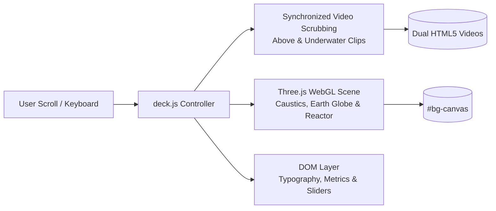

# Hydro Industries — Next-Generation Interactive Deck

<div align="center">
  
  <br><br>
  <p><strong>A cinematic, scroll-choreographed interactive presentation deck engineered for Hydro Industries.</strong></p>
  <p>Seamlessly fusing 4K aerial & underwater continuous water flights, real-time WebGL 3D layers, a photorealistic Earth model with verified geographic hubs, and live engineering simulation.</p>
</div>

---

## 🌟 Key Highlights

- 🌐 **Live Demo (GitHub Pages)**: [**https://inhaus-developer-team.github.io/hydro-interactive-deck/**](https://inhaus-developer-team.github.io/hydro-interactive-deck/)
- 🌊 **Continuous Water Flight Choreography**: Dual-clip background engine (aerial to submarine) with seamless seam-frame handover at $50\%$ timeline progress, synchronized directly to wheel, touch, and trackpad scroll.
- 🌍 **Photorealistic 3D Earth Globe**: Accurate spherical projection mapping for active global subsidiaries (UK HQ, Ecuador, Colombia, Saudi Arabia, Egypt, Bahrain) with orbital energy arcs and Fresnel atmospheric Rayleigh scattering.
- ⚡ **3D Modular Electro-Coagulation Reactor**: Technical 3D model with refractive glass vessel (`MeshPhysicalMaterial`), active anode/cathode rods, and pulsed plasma discharge.
- 🔬 **Interactive Turbidity Clarification Simulator**: Live physics slider demonstrating NTU reduction from $850$ down to $<5\text{ NTU}$ with dynamic power ($0.45\text{ kWh/m}^3$) and sludge calculations.
- 🗂️ **Engineering Slide-Out Drawer & Thumbnail Grid**: Deep-dive technical specifications on demand with keyboard shortcuts (`D` for Details, `G` for Grid Matrix).
- ♿ **Modern Web Standards & Accessibility**: WCAG 2.1 AA compliant, high-contrast typography, semantic ARIA roles, responsive fluid layout across desktop, tablets, and smartphones.

---

## 📸 Visual Previews & Media

<div align="center">
  
</div>

### 1. Cover & Aquatic Visual Engine
The opening stage features monumental typography, layered fluid ribbons, and background drone footage capturing coastal currents.

### 2. High-Performance Media Assets
- **Aerial Water Flight**: [`assets/videos/hydro_flight_above.mp4`](assets/videos/hydro_flight_above.mp4) (4K flight across open waters)
- **Submarine Water Flight**: [`assets/videos/hydro_flight_under.mp4`](assets/videos/hydro_flight_under.mp4) (Deep aquatic dive through sunlit swells)
- **High-Resolution Realistic Earth**: [`assets/images/earth_surface_realistic.jpg`](assets/images/earth_surface_realistic.jpg) (2048x1024 continental and bathymetric map)
- **Verified Reference Photography**: [`assets/images/beeah_plant.jpg`](assets/images/beeah_plant.jpg), [`assets/images/quito_plant.jpg`](assets/images/quito_plant.jpg)

---

## 📐 System Architecture



---

## 🚀 Quick Start Guide

This project requires **zero build tools, zero dependencies, and no npm install**. It runs instantly in any modern web browser.

### 1. Clone the Repository
```bash
git clone https://github.com/Inhaus-Developer-Team/hydro-interactive-deck.git
cd hydro-interactive-deck
```

### 2. Start Local Server
Run with Python 3:
```bash
python3 -m http.server 8765
```

Or using PHP:
```bash
php -S localhost:8765
```

### 3. Open in Browser
Navigate to:
```
http://localhost:8765/
```

---

## ⌨️ Keyboard Shortcuts & Presentation Controls

| Shortcut | Action | Description |
| :--- | :--- | :--- |
| `Space` / `→` / `↓` / `PageDown` | **Next Slide** | Advances to the next narrative slide |
| `←` / `↑` / `PageUp` | **Previous Slide** | Moves back to the previous slide |
| `Key D` | **See Details** | Opens the slide-out engineering spec drawer |
| `Key G` | **Grid Matrix** | Opens the full 13-slide thumbnail overview |
| `Escape` | **Close Overlays** | Dismisses drawer or thumbnail modal |
| `Home` / `End` | **Jump** | Jumps directly to Cover (01) or Closing (13) |

---

## 📚 Documentation Index

- 📋 [**Product Requirements Document (PRD)**](docs/specs/PRD.md): User personas, functional scope, slide inventory, and non-functional requirements.
- 🏛️ [**Technical Architecture Specification**](docs/architecture/TECHNICAL_SPEC.md): WebGL shader mathematics, coordinate projection formulas, and video scrubbing mechanics.
- 📖 [**Operator & Presenter Manual**](docs/guides/OPERATOR_MANUAL.md): Step-by-step presentation guide for conferences and client meetings.
- 🤖 [**LLMS.txt Agent Guidelines**](LLMS.txt): Context, system boundaries, and compliance rules for AI coding assistants.

---

## 🏢 Governance & Compliance

- **Organization**: [Inhaus Developer Team](https://github.com/Inhaus-Developer-Team)
- **Lead / Admin**: [@nortoninhaus](https://github.com/nortoninhaus)
- **Brand Trademarks**: All trademarks and logos are property of **Hydro Industries Limited** (United Kingdom).
