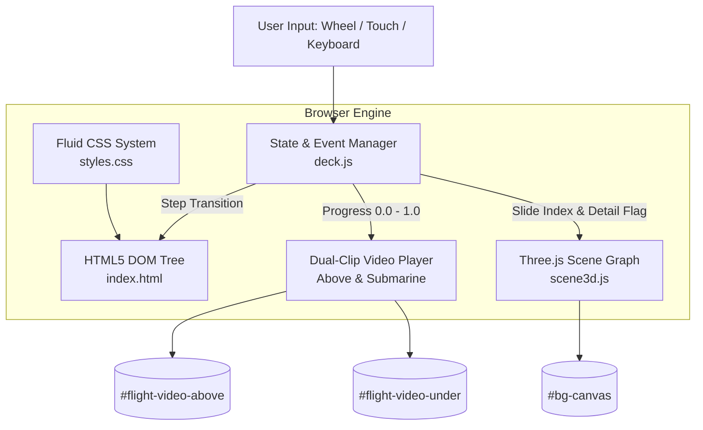
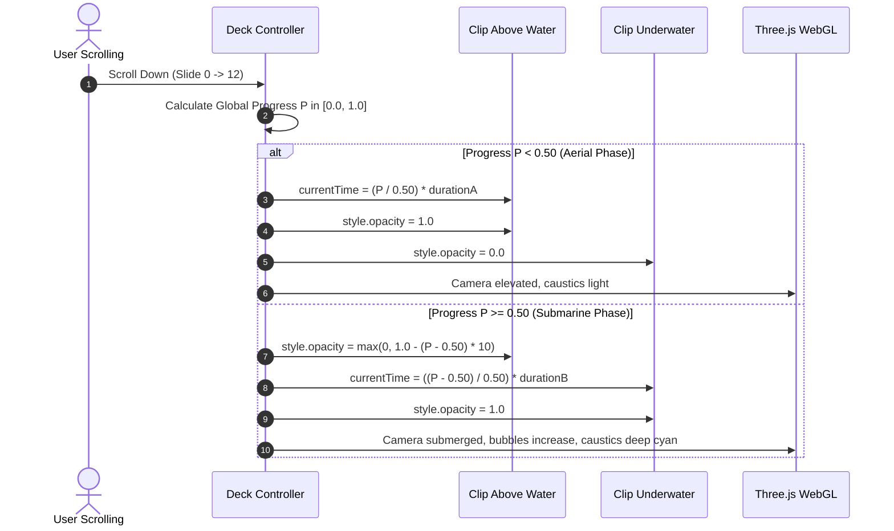
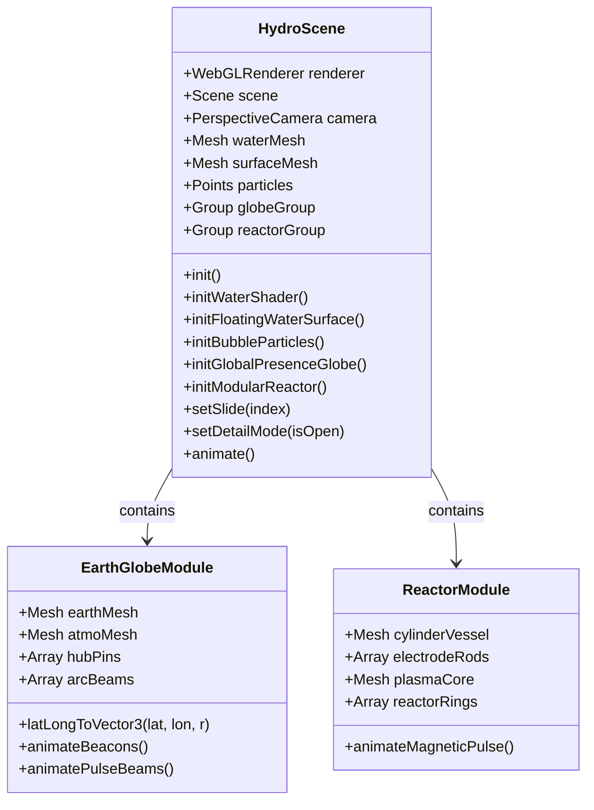
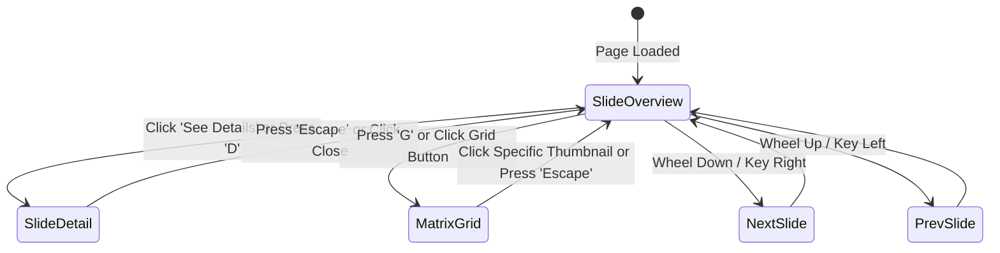

# Architecture & Technical Design Specification
## Hydro Interactive Presentation Deck

This document details the software architecture, WebGL rendering pipeline, coordinate transformations, and scroll choreography mechanics of the Hydro Interactive Deck.

---

## 1. System Architecture Overview



---

## 2. Dual-Clip Continuous Flight Choreography

Inspired by the Marlin continuous scroll mechanism, the background comprises two synchronized 4K video clips that hand over at a seamless junction:



---

## 3. WebGL Layer Architecture (`scene3d.js`)



### 3.1 Caustics Shader Formula
The background fluid simulation uses a custom GLSL fragment shader combining dual domain-warped sine waves:
$$\eta(x, y, t) = \sin(x \cdot 0.35 + t \cdot 0.8) \cos(y \cdot 0.28 + t \cdot 0.6) + \sin(x \cdot 0.9 - t \cdot 1.1) \cdot 0.15$$

### 3.2 Atmospheric Rayleigh Scattering (Fresnel Shell)
$$\text{Fresnel} = \left( 1.0 - \max\left( \vec{V} \cdot \vec{N}, 0.0 \right) \right)^{3.2}$$
where $\vec{V}$ is the camera view direction and $\vec{N}$ is the surface normal.

---

## 4. State Management & Navigation Engine (`deck.js`)



### Keyboard Shortcut Mapping

| Key Code | Target Action |
| :--- | :--- |
| `ArrowRight` / `ArrowDown` / `PageDown` / `Space` | Advance to next slide |
| `ArrowLeft` / `ArrowUp` / `PageUp` | Return to previous slide |
| `KeyD` | Toggle engineering deep-dive drawer |
| `KeyG` | Toggle thumbnail navigation matrix |
| `Escape` | Dismiss any open modal or drawer |
| `Home` / `End` | Jump to Cover (01) or Closing (13) |

---

## 5. Directory & Asset Mapping

```
hydro-interactive-deck/
├── assets/
│   ├── brand/
│   │   ├── hydro_logo_white.png       # Official white Hydro vector logo
│   │   └── hydro_logo_color.png       # Official dual-tone brand logo
│   ├── images/
│   │   ├── earth_surface_realistic.jpg# 2048x1024 high-res Earth texture
│   │   ├── beeah_plant.jpg            # BEE'AH Sharjah reference photography
│   │   ├── quito_plant.jpg            # Quito Leachate plant reference
│   │   ├── water_engineers.jpg        # Field engineers on-site
│   │   ├── equipment_skid.jpg         # Modular treatment skid rendering
│   │   └── water_monument_cutout.png  # Hero transparent cutout
│   └── videos/
│       ├── hydro_flight_above.mp4     # Aerial water flight clip
│       ├── hydro_flight_under.mp4     # Submarine water flight clip
│       └── hydro_ambient_water.mp4    # Ambient caustic loop
├── docs/
│   ├── architecture/TECHNICAL_SPEC.md # This architecture document
│   ├── guides/OPERATOR_MANUAL.md      # Presentation & deployment guide
│   └── specs/PRD.md                   # Product requirement document
├── index.html                         # Semantic 13-slide master layout
├── deck.js                            # Interactive slide & state choreography
├── scene3d.js                         # Three.js WebGL multi-layer engine
├── styles.css                         # CSS design system & responsive styling
├── README.md                          # Repository landing page
├── LLMS.txt                           # Machine-readable context for AI agents
└── .gitignore                         # Version control ignore rules
```
