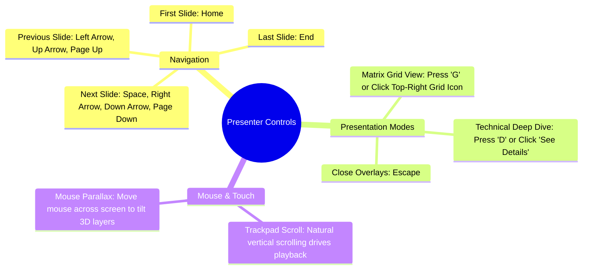

# Operator & Presenter Guide
## Hydro Interactive Presentation Deck

This guide assists executives, presenters, and engineers in operating and presenting the Hydro Interactive Deck in live meetings, investor presentations, and conferences.

---

## 1. Quick Start & Local Run

No build step, bundler, or Node.js environment is required. You can serve the deck using any static HTTP server.

### Option A: Python 3 (Recommended)
```bash
cd /path/to/hydro-interactive-deck
python3 -m http.server 8765
```
Open your browser at:
`http://localhost:8765/`

### Option B: PHP Built-in Server
```bash
php -S localhost:8765
```

### Option C: Caddy / Nginx / Apache
Point the root web directory to `hydro-interactive-deck/` and ensure CORS headers allow loading local video assets.

---

## 2. Presenter Controls & Shortcuts



---

## 3. High-Impact Slide Walkthroughs

### Slide 01: Cover — *Engineering Pure Water*
- **Visual:** Monumental typography with floating water cutout and aerial drone flight over clear coastal currents.
- **Talking Point:** "Hydro Industries redefines industrial and municipal water remediation through chemistry-free electro-coagulation."

### Slide 06: Performance Proof — *Turbidity Clarification Simulator*
- **Action:** Drag the interactive slider from left to right.
- **Visual:** Watch the live NTU reading drop from `850 NTU` to `< 5 NTU`, the energy calculation calibrate to `0.45 kWh/m³`, and the background water clarity transform from murky to crystal clear.
- **Talking Point:** "In real-time field deployments, our automated systems clarify heavily polluted runoffs with 99.4% efficacy without bulk chemicals."

### Slide 10: Global Structure — *Photorealistic 3D Earth*
- **Visual:** A photorealistic rotating 3D Earth appears on the right half with an atmospheric blue glow. Pulsing beacons highlight the UK HQ, Quito, Bogotá, Riyadh, Cairo, and Bahrain. Glowing curved orbital arcs show energy paths connecting the UK to international subsidiaries.
- **Talking Point:** "We operate as a unified global group with active engineering hubs across Latin America, the UK, and the Gulf Region."

---

## 4. Hardware & Browser Recommendations

- **Displays:** Optimized for 1080p, 1440p, 4K UHD, and ultra-wide presentation displays.
- **Browsers:**
  - Google Chrome (v110+)
  - Apple Safari (v16+)
  - Mozilla Firefox (v110+)
  - Microsoft Edge (v110+)
- **Mobile Devices:** Fully responsive on iOS (Safari) and Android (Chrome) with touch swipe navigation.
