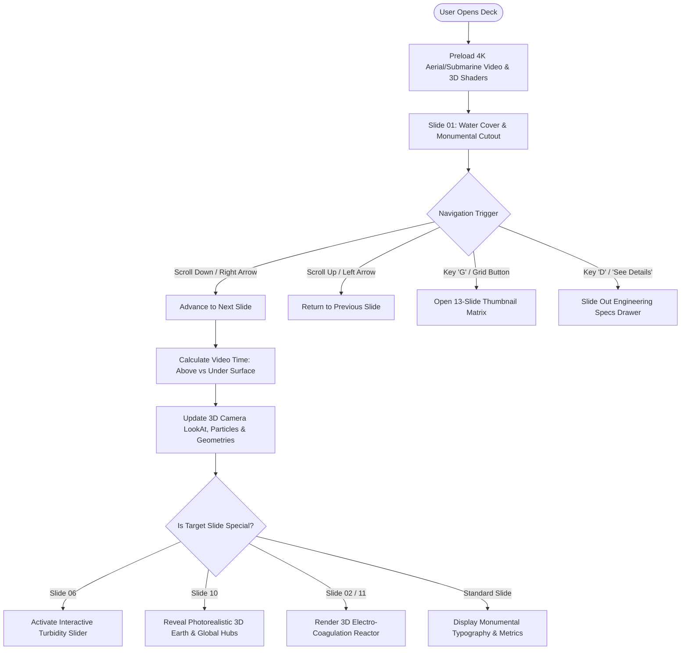

# Project Requirement Document (PRD)
## Hydro Industries — Next-Generation Interactive Presentation Deck

- **Project Name:** Hydro Interactive Deck
- **Version:** 2.4.0 (Production Release)
- **Organization:** Inhaus Developer Team
- **Owner / Administrator:** `@nortoninhaus`
- **Target Audience:** C-level Executives, Institutional Investors, Municipal Authorities, Environmental Agencies
- **Status:** Approved / Production

---

## 1. Executive Summary & Problem Statement

### 1.1 Context
Hydro Industries is a global cleantech leader specializing in advanced water treatment, industrial effluent remediation, and modular electro-coagulation systems. The legacy delivery format (static 16:9 PDF decks) failed to convey the technical scale, hydrodynamic elegance, and engineering precision of Hydro's international operations across the UK, Latin America, and the Middle East.

### 1.2 Core Objective
To engineer a **cinematic, scroll-choreographed interactive deck** inspired by high-end performance web experiences (such as the *Marlin* continuous flight paradigm), seamlessly combining:
1. Continuous aerial & submarine water-flight backgrounds (dual-clip seam transition).
2. Real-time WebGL 3D layers (dynamic caustics, floating particles, volumetric fluid planes).
3. A photorealistic, scientifically accurate 3D model of planet Earth showcasing active global entities (UK, Ecuador, Colombia, Saudi Arabia, Egypt, Bahrain).
4. Interactive technical simulations (live Turbidity NTU clarification slider, real-time metrics, slide-out engineering spec drawers).
5. Strict brand compliance, high-contrast accessible typography, and keyboard/wheel/touch ergonomics.

---

## 2. User Personas & Experience Goals

| Persona | Role | Key Goal | Interaction Trigger |
| :--- | :--- | :--- | :--- |
| **Executive / Investor** | Chief Investment Officer, Infrastructure Fund | Assess corporate governance, international footprint, and verified treatment tonnage | Planetary 3D Hubs (Slide 10), Timeline (Slide 09) |
| **Municipal Engineer / Client** | Director of Water Utilities | Evaluate treatment efficacy (turbidity reduction, contaminants, sludge volume) | Turbidity Clarification Simulator (Slide 06) |
| **Industrial Operator** | Plant Manager, Refinery / Mining | Verify modular deployment speed and turnkey skid capabilities | Electro-Coagulation Reactor 3D Model (Slide 02, 11) |
| **Presenter / Sales Leader** | Hydro Pre-Sales Director | Deliver fluid boardroom pitches with zero lag, instant slide jumping, and deep-dive drawer | Keyboard shortcuts (`Space`, `Arrow`, `D`, `G`), Matrix Grid Modal |

---

## 3. Product Architecture & Layer Stack

The deck uses a **4-layer depth compositing model** operating simultaneously in coordinate space:

```
+-------------------------------------------------------------------------+
| Layer 4: FOREGROUND (DOM UI, Headings, Numbers, Drawer, Matrix Grid)   |
+-------------------------------------------------------------------------+
                                    |
                                    v
+-------------------------------------------------------------------------+
| Layer 3: MIDDLEGROUND 3D (Photorealistic Earth, Reactor, Cutouts)       |
+-------------------------------------------------------------------------+
                                    |
                                    v
+-------------------------------------------------------------------------+
| Layer 2: MIDDLEGROUND FLUID (Three.js Caustics, Bubbles, Wave Surface) |
+-------------------------------------------------------------------------+
                                    |
                                    v
+-------------------------------------------------------------------------+
| Layer 1: BACKGROUND (Seamless Dual-Clip 4K Drone Water Flight)         |
+-------------------------------------------------------------------------+
```

### Flowchart of User Journey & State Transitions



---

## 4. Functional Specifications

### 4.1 Slide Catalog & Content Inventory (13 Total Slides)

```mermaid
graph LR
    S01["01: Cover<br>Engineering Pure Water"] --> S02["02: Overview<br>Mission & Modular Tech"]
    S02 --> S03["03: Problem<br>Global Contamination"]
    S03 --> S04["04: Capability<br>Total Remediation"]
    S04 --> S05["05: Technology<br>Electro-Coagulation"]
    S05 --> S06["06: Turbidity<br>Interactive NTU Sim"]
    S06 --> S07["07: Deployments<br>Global Applications"]
    S07 --> S08["08: Impact<br>ESG & Metric Proof"]
    S08 --> S09["09: Timeline<br>History of Innovation"]
    S09 --> S10["10: Structure<br>3D Earth & Active Hubs"]
    S10 --> S11["11: Case Study<br>BEE'AH Sharjah 500m³/d"]
    S11 --> S12["12: Projects<br>Latin America Focus"]
    S12 --> S13["13: Summary<br>Closing Vision & Call"]
```



### 4.2 Interactive Clarification Simulator (Slide 06)
- **Input:** Native touch/mouse range slider from `0%` to `100%`.
- **Outputs Real-Time Calculation:**
  - Raw Inflow: `850 NTU` down to Clean Outflow: `< 5 NTU` ($99.4\%$ reduction).
  - Power draw: `0.45 kWh/m³`.
  - Sludge reduction: `85%` lower vs chemical clarification.
  - Three.js water caustics dynamically clear from murky brown-ochre to crystalline cyan.

### 4.3 3D Photorealistic Earth Globe (Slide 10)
- **Geometry & Textures:** 2K high-resolution equirectangular texture map with PBR roughness/bump parameters.
- **Atmosphere:** Backside Fresnel glow shell simulating blue atmospheric Rayleigh scattering.
- **Accurate Geographic Projections:**
  $$\phi = (90 - \text{lat}) \cdot \frac{\pi}{180}, \quad \theta = (\text{lon} + 180) \cdot \frac{\pi}{180}$$
  $$X = -R \sin(\phi) \cos(\theta), \quad Y = R \cos(\phi), \quad Z = R \sin(\phi) \sin(\theta)$$
- **Active Hubs & Routing:**
  - London UK (HQ): `51.5° N, -0.12° W`
  - Quito Ecuador: `-0.18° S, -78.46° W`
  - Bogotá Colombia: `4.71° N, -74.07° W`
  - Riyadh Saudi Arabia: `24.71° N, 46.67° E`
  - Cairo Egypt: `30.04° N, 31.23° E`
  - Manama Bahrain (JV): `26.22° N, 50.58° E`
  *(Note: All historical references to Namibia, Slovakia, and Morocco are permanently excluded per compliance requirements).*

---

## 5. Non-Functional & Performance Requirements

1. **Frame Rate:** Sustained 60 FPS on modern desktop browsers (Chrome, Safari, Firefox, Edge) and minimum 45 FPS on mobile devices.
2. **Audio/Video Scrubbing Latency:** $< 65 \text{ ms}$ seek time utilizing hardware-accelerated HTML5 video elements.
3. **Accessibility (WCAG 2.1 AA):**
   - High-contrast typography minimum ratio of `4.5:1` (`rgba(255, 255, 255, 0.88)` on dark aquatic backdrops).
   - Full keyboard navigability (`Tab`, `Enter`, `Escape`, `Arrow` keys).
   - Semantic ARIA tags on all interactive buttons, sliders, and modal triggers.
4. **Zero External Runtime Dependencies:** Runs completely standalone with vanilla JavaScript, CSS custom properties, and CDN-cached Three.js r128.
